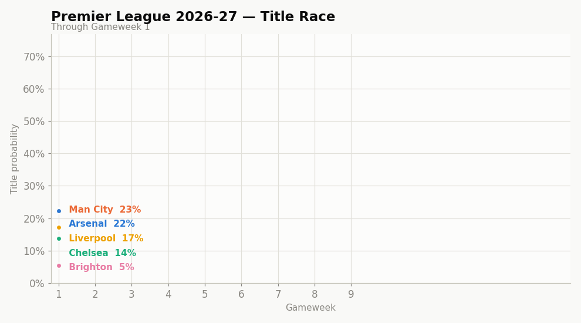
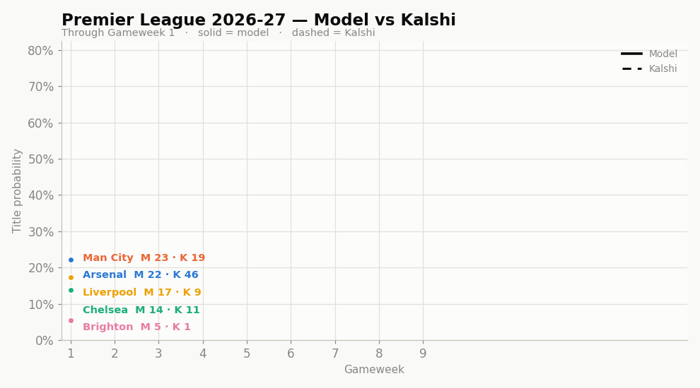

# Premier League Title Prediction

An LSTM model that estimates each club's probability of winning the Premier League
title, updated week-by-week through the season. The model predicts each club's
**final-season points** from its form so far; title odds are the share of **20,000
simulated season-endings** in which a club finishes top — **Kalshi-style percentages**,
one per team per gameweek, summing to 100%.



> The GIF above regenerates every gameweek. An interactive version (crosshair
> tooltips, per-team table, dark mode) is built at `outputs/dashboard.html`.

---

## How It Works

### Data
Match results are downloaded from **[football-data.co.uk](https://www.football-data.co.uk/)**
— free, no API key, every PL season from 1993-94 onwards. From the raw fixtures the
pipeline derives two things:

- **`data/historical_matches.csv`** — one row per fixture (the Elo engine's input)
- **`data/historical_standings.csv`** — one row per team per game played (points,
  goals, form, live position after every game)

### Features
Each row is a team's state after their Nth game of the season.

**Absolute** — `position`, `form` (last-5 as W=3/D=1/L=0), `won`/`draw`/`lost`,
`points`, `goalsFor`/`goalsAgainst`/`goalDifference`, `games_remaining`.

**Relative** — `points_per_game`, `points_gap_from_leader` (0 for the leader,
negative otherwise), `max_obtainable_points` (`points + games_remaining × 3`, the
title ceiling).

**Performance** — `shot_att` and `shot_def`: rolling (last-5) chance quality a team
**creates** vs **concedes** (shots on target weighted over total shots). Split into
separate attacking and defensive signals so the model can value a mean defence on its
own, not just a net shot differential.

**Strength of schedule** — `sos_played` and `sos_remaining`: the average Elo of the
opponents a team has already faced vs those still to come (remaining fixtures derived
from the double round-robin), centred on the league mean. Distinguishes points earned
against a brutal run from the same points against a soft one.

**Pre-season priors** — the signals that make gameweek-1 odds realistic before any
results exist. They are **direct features**, so the model *learns* their weight:
- **`prev_position`** — the team's final league position last season (promoted /
  previously-absent teams get 21). A clean prior for *every* team, not just champions.
- **`squad_value_z`** — within-season z-score of log squad market value (below).
- **`trophy_score`** — stacked prestige of the trophies the club won the previous
  season (PL/CL/EL/FA/League Cup/ECL).
- **`elo`** — a **pure results-based** strength rating (below).

### Elo — pure results
The Elo is a proper chained rating updated after **every match** across all history,
like [clubelo](http://clubelo.com/) / FiveThirtyEight:

```
expected_home = 1 / (1 + 10^((elo_away − (elo_home + home_adv)) / 400))
delta         = K × goal_diff_multiplier × (result − expected_home)
elo_home += delta ;  elo_away −= delta
```

It only ever sees match results — **no prestige seeding**. At each season's start a
team's rating is a plain mean-reverted carryover, `1500 + 0.85 × (prev_end_elo − 1500)`;
new/promoted teams enter at `1425`. The prestige context (squad value, trophies, last
year's finish) used to be *added into* this seed as hand-picked bonuses, which made the
weight of those priors a human guess. They are now **separate model features**
(`squad_value_z`, `trophy_score`, `prev_position`), so the LSTM learns how much each is
worth and Elo stays a clean, competition-agnostic measure of on-pitch results.

The three Elo constants are **fitted, not hand-set**: `fit_elo_params()` grid-searches
`K`, `HOME_ADVANTAGE` and `SEASON_REGRESSION` for the lowest one-step match-prediction
Brier over all PL history (→ `K=12`, `HFA=65`, `REG=0.85`). All constants live at the
top of [`src/prem_prediction/elo.py`](src/prem_prediction/elo.py).

### Squad market value — the pre-season prior that makes GW1 realistic
Total squad market value is the single strongest predictor of where a club finishes,
and it captures what a league table cannot: transfer spending and the raw quality gap
between the elite and everyone else. Prediction markets move on exactly this
information, so feeding it to the model makes pre-gameweek-1 odds far more realistic —
without it, every team starts a season clustered near 5% (a 20:1 field), which is
nonsense.

Values are scraped from **Transfermarkt** (`squad_value.py` → `data/squad_values.csv`,
2005-present) and fed to the model as `squad_value_z`:

```
squad_value_z = z          where z = within-season z-score of log(squad value)
```

Two deliberate choices:
- **Relative, not absolute.** Using the z-score *within each season* makes it immune
  to decades of transfer-fee inflation — a 2008 squad and a 2026 squad are scored on
  the same relative scale, against their own peers.
- **The log** tames the heavy right tail (a handful of super-clubs) so the spread is
  roughly symmetric.

Seasons before ~2005 (no data) get `0`. Because it is a direct feature rather than an
Elo seed, the LSTM sets its own weight on it.

### Model — predict the table, simulate the title
A two-layer LSTM with masking and dropout predicts each club's **final-season points**:

```
Masking → LSTM(64) → Dropout(0.3) → LSTM(32) → Dropout(0.3) → Dense(1)   # final points
```

Trained as a regression (`Huber` loss) on the `final_points` target. Why points and not
a win/lose label: the model learns *what makes the standings*, and title odds fall out
of the predicted table rather than being the only thing it can say.

**From points to title odds.** The raw forecast is blended with a simple current-pace
projection (`points + ppg × games_remaining`), weighted `gw / (gw + 6)` so the LSTM's
pre-season priors lead early and the pace anchor takes over by mid-season. Each team's
final total is then sampled `N(blended_forecast, σ[gw])` — clipped to `[points already
earned, max still obtainable]` — and the **title probability is the fraction of 20,000
simulations in which that team finishes top**. `σ[gw]` is the model's own out-of-season
error at each stage (`±12` pts at GW1, `±1` by GW38), so the odds sharpen as the season
runs out.

**Partial-sequence training:** sequences are cut at gameweeks 1, 2, 3, 5, 10, … 38 and
zero-padded, so the model makes confident calls at every stage. The early cutoffs (1-3)
are what teach it to lean on the pre-season priors — without them a GW1 sequence is
out-of-distribution.

---

## Model vs Kalshi — a live market benchmark

The model is a forecast; **[Kalshi](https://kalshi.com/)** is a real-money prediction
market on the exact same question. Lining the two up is the most honest test of whether
the model is *realistic*. Kalshi's public API is free — no key, no per-call cost — so
[`kalshi.py`](src/prem_prediction/kalshi.py) pulls its Premier League "winner" market for
the season in progress and compares it, gameweek by gameweek, to our own probabilities.



> Solid = model, dashed = Kalshi. Rebuilt every gameweek by `update.py`.

Two choices keep the comparison fair:
- **Normalisation.** Each club is its own binary market, so the 20 YES prices don't sum
  to 100% (≈97% early in 2026-27). Each day is renormalised to a proper distribution
  before it's compared to the model's simulated title odds.
- **Alignment.** The model updates per gameweek; the market trades continuously. Each
  gameweek is matched to the date the round finished, and Kalshi is sampled at its last
  quote on or before that date — so both sides use only what they knew at the time.

### Week by week (model `M` vs Kalshi `K`)

<!-- KALSHI_TABLE:START --> <!-- regenerated by update.py each gameweek; do not edit by hand -->
*2026-27, through gameweek 9.*

| GW | Arsenal (M / K) | Man City (M / K) | Liverpool (M / K) | Model leader | Kalshi leader |
|---:|---|---|---|---|---|
| 1 | 22% / 46% | 22% / 19% | 16% / 9% | Arsenal | Arsenal |
| 2 | 45% / 44% | 42% / 20% | 5% / 4% | Arsenal | Arsenal |
| 3 | 50% / 47% | 40% / 22% | 7% / 6% | Arsenal | Arsenal |
| 4 | 53% / 54% | 45% / 30% | 2% / 4% | Arsenal | Arsenal |
| 5 | 31% / 44% | 58% / 37% | 6% / 4% | Man City | Arsenal |
| 6 | 28% / 62% | 68% / 22% | 1% / 4% | Man City | Arsenal |
| 7 | 27% / 56% | 68% / 21% | 1% / 5% | Man City | Arsenal |
| 8 | 45% / 66% | 50% / 17% | 3% / 5% | Man City | Arsenal |
| 9 | 64% / 68% | 30% / 13% | 1% / 5% | Arsenal | Arsenal |
<!-- KALSHI_TABLE:END -->

> This table regenerates every gameweek (`update.py`), as do the animation above and
> `dashboard.html` (which has its own Model / Kalshi / Edge column).

The two broadly agree on the **shape** of the race — a two-horse Arsenal/City lead,
everyone else near zero — and on the favourite at the latest gameweek. The stretch to
watch is **mid-season**, where the model has leaned toward City on their on-pitch form
while the market held firm on Arsenal (next section).

### Where they diverge — the model is a pure on-pitch read

The model chased City's **mid-season form**: across GW5–8 City were dominating the
underlying numbers (shots, chances, goal margin), so the final-points forecast projected
them to overhaul Arsenal. The market never followed, for a reason the model has no feature
for. In February 2023 the Premier League charged City with **115 alleged breaches** of its
financial rules (2009–2018); in September 2026 an independent commission **reportedly found
the club in breach on 114 of the 115 charges** — no sanction set, an appeal expected, but
the market is pricing the risk of a **points deduction**. So Kalshi kept City suppressed
(~13–37%) even while City were winning on the pitch, and by GW9 — as Arsenal's lead held
and City dropped points — the model reconverged on Arsenal.

This is exactly the model's boundary. It's a strong read of on-pitch information, but a
market folds in exogenous shocks — legal rulings, injuries, managerial changes — that a
results-based model cannot see. The Kalshi overlay is kept precisely so that gap is visible
rather than hidden.

*Sources: [beIN Sports, 25 Sep 2026](https://www.beinsports.com/en-us/soccer/premier-league/articles/manchester-city-receives-verdict-on-115-premier-league-charges-2026-09-25);
[Yahoo Sports — the 115 charges explained](https://sports.yahoo.com/articles/man-city-115-charges-key-161032453.html).*

---

## Project Layout

```
src/prem_prediction/     # the package
  data_acquisition.py    #   download fixtures, build standings
  elo.py                 #   pure results-based Elo (fitted K/HFA/regression)
  squad_value.py         #   Transfermarkt squad-value scraper
  trophy_data.py         #   historical trophy winners + bonus values
  match_stats.py         #   shot_att / shot_def (chances created vs conceded)
  schedule_strength.py   #   sos_played / sos_remaining (opponent-Elo schedule strength)
  prepare_model_data.py  #   features, priors, final_points target, Elo/shot/SOS merge
  model_train.py         #   final-points LSTM + per-gameweek residual-std calibration
  season_predict.py      #   final-points → simulated title odds → predictions.json
  kalshi.py              #   pull + align the live Kalshi title market (free API)
  evaluate.py            #   grouped-season CV of the title ranking
  viz.py                 #   title_race.gif + model_vs_kalshi.gif + dashboard.html
  build_dataset.py       #   full historical rebuild
  add_season.py          #   append a finished season
  update.py              #   gameweek refresh (predict + viz)
  config.py / paths.py   #   season detection, filesystem paths
scripts/update.py        # thin wrapper: python scripts/update.py
data/                    # matches, standings, out.csv, squad_values.csv, kalshi_current.csv
models/                  # best_model.h5, scaler.joblib, point_residual_std.json
outputs/                 # predictions.json, title_race.gif, model_vs_kalshi.gif, dashboard.html, evaluation.json
```

The current season is detected automatically from the date (`config.current_season_start_year`),
so nothing is hard-coded to a particular year.

---

## Setup

```bash
pip install -r requirements.txt
pip install -e .          # makes `python -m prem_prediction.*` work
```

## Running the Pipeline

```bash
# 1. Scrape squad market values (Transfermarkt, 2005 → current season)
python -m prem_prediction.squad_value

# 2. Build the training dataset (downloads 1993-94 → latest completed season)
python -m prem_prediction.build_dataset

# 3. Train the model
python -m prem_prediction.model_train

# 4. Predict the current season + build the graph/dashboard
python -m prem_prediction.update
```

`update` is the one you re-run each gameweek: it pulls the latest results, re-scores
every completed gameweek, refreshes the Kalshi market comparison, and rebuilds
`outputs/title_race.gif`, `outputs/model_vs_kalshi.gif`, and `outputs/dashboard.html`.
It does **not** retrain — that only happens once a season, after it completes.

The Kalshi comparison can also be refreshed on its own (free public API, no key):

```bash
python -m prem_prediction.kalshi     # writes data/kalshi_current.csv
```

## Adding a Finished Season

When a season ends, append it and retrain:

```bash
python -m prem_prediction.add_season --season 2025 \
    --pl Arsenal --fa "Man City" --lc "Man City" \
    --cl None --el "Aston Villa" --ecl "Crystal Palace"
python -m prem_prediction.model_train
```

Team names must match the football-data.co.uk convention exactly
(`"Man City"`, `"Nott'm Forest"`, …).

## Evaluation

The shipped product is the **simulated title ranking**, so `evaluate.py` scores exactly
that on **held-out whole seasons** (grouped k-fold, no sequence leaks), against a trivial
"current league leader wins" baseline:

```bash
python -m prem_prediction.evaluate            # 5-fold, writes outputs/evaluation.json
```

Held-out results (33 seasons; `champ prob` = probability mass on the eventual champion;
uniform guess = 5%):

| GW | model top-1 | leader top-1 | champ log-loss | champ prob |
|---:|---:|---:|---:|---:|
| 1 | **0.27** | 0.09 | 2.08 | 13.3% |
| 10 | 0.39 | 0.45 | 1.34 | 33.8% |
| 19 | **0.61** | 0.58 | 1.04 | 44.8% |
| 30 | 0.79 | 0.79 | 0.46 | 69.2% |
| 38 | 1.00 | 1.00 | 0.00 | 100% |
| **all** | **0.63** | 0.60 | **0.95** | — |

The model **beats the "back the leader" baseline overall** (top-1 0.63 vs 0.60, log-loss
0.95). Its edge is biggest **early**, where a
market has value — at GW1 it ranks the eventual champion first three times as often as
reading the table (0.27 vs 0.09). Mid-to-late it matches the baseline, which is the
ceiling of the problem: once ~25 games are played, "who's top" is already near-decisive.

> **Earlier design.** The model previously output a per-team logit passed through a
> softmax, trained as a binary "won the league" classifier, with the priors hard-coded
> into the Elo seed. The current table-regression + simulation approach (priors as
> learned features, pace-anchored) is better calibrated (log-loss 0.97 vs 1.10) and more
> intuitive — it predicts the standings, and the title odds fall out of them.

## Automated Weekly Refresh

A scheduled **cloud agent** runs the refresh every week and pushes the updated
predictions, graphs and dashboard to `main` — no local machine involved. It currently
fires **Tuesdays at 13:00 UTC** (after the weekend/midweek rounds): it installs deps,
runs `python -m prem_prediction.update` (re-score only — it does **not** retrain), and
commits `outputs/` if anything changed.

Set one up (or change the schedule) with the `/schedule` command in Claude Code; it needs
GitHub connected to your Claude account (`/web-setup` or https://claude.ai/connect-github)
and the code on `main`.

---

## Configuration Notes

- `constants.py` is gone. The legacy football-data.org API key (only used by the
  optional `FootballDataAPI` wrapper) is now read from the `FOOTBALL_DATA_API_KEY`
  environment variable — see `.env.example`. The main pipeline needs no key.
